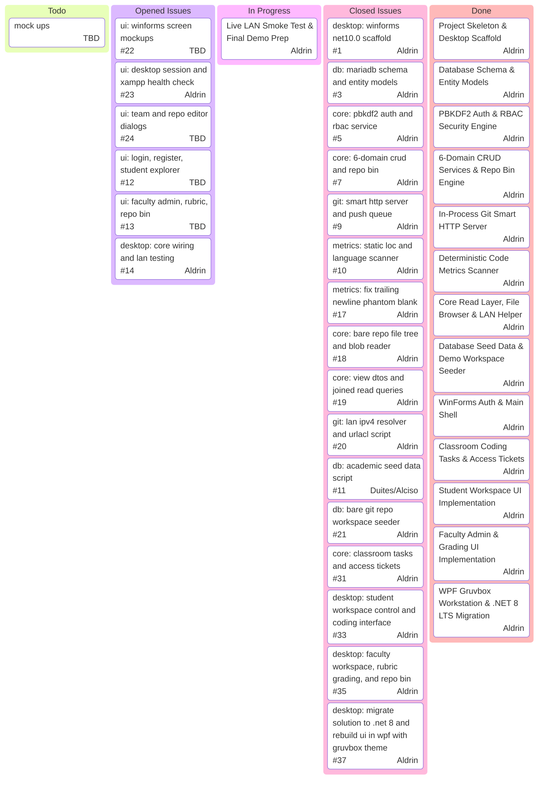

<div align="center">


<sub style="font-weight: bold;"> Local Git archive server and academic repository catalog for CSD students from UCC built with C# WPF (.NET 8 LTS, Gruvbox Theme) and MySQL/MariaDB (XAMPP) </sub>
</div>
<br><br>

## Overview

Repo Vault provides a local area Git HTTP server and desktop workstation for archiving, inspecting, and grading student programming repositories without relying on cloud hosting. Students can register accounts, push and clone repositories over LAN using standard Git commands, browse source trees, and leave peer review feedback. Faculty members can manage course catalogs, inspect code metrics (source, comment, and blank lines), lock repositories after deadlines, soft-delete archives via the Repo Bin, and record rubric evaluations.

## Prerequisites

Before cloning and building the project, make sure the following tools are installed on your machine:

1. **.NET 8 LTS SDK** (`8.0` or newer) - verify with `dotnet --version` or `dotnet --info`
2. **XAMPP** (with MySQL/MariaDB service running on port `3306`)
3. **Git CLI** (`git.exe` on Windows or `git` on Linux) added to your system PATH
4. **Visual Studio 2022** (with .NET Desktop Development workload, open `RepoVault.sln`) or **Neovim / VS Code**

## Project Structure (monorepo)

- `src/RepoVault.Core` - Database access (MariaDB), RBAC authentication, Git HTTP server (`HttpListener`), and static code metrics scanner
- `src/RepoVault.Desktop` - Native WPF desktop client (`.NET 8`, Gruvbox Light/Dark dynamic theme, Version B Classroom UX)
- `tests/RepoVault.Tests` - Unit tests for database queries, line counting, and server handlers.
- `database/schema.sql` - SQL script to initialize the `repo_vault_db` schema in phpMyAdmin or MariaDB CLI.

## Notes and Roles

> [!IMPORTANT]
> Update your row in your pull request when starting or finishing a task/submitting PR



## Contribution Guide for Members

Please FOLLOW and READ these steps when picking up a task so we wont overwrite some random files:

### 1. Opening an Issue

> [!NOTE]
> please follow this guide accordingly to keep the project workflow in order thank you in advance

1. Go to the [issue](https://github.com/frtzhahn/repo-vault/issues) tab on GitHub and click **New issue**.
2. Title it with the module name, for example: `[ui] add faculty rubric grading form`.
3. Briefly list what files or forms you plan to add or edit, then assign the issue to yourself or to someone assigned on the specific field.

### 2. Creating a Branch

> [!WARNING]
> Never commit or push directly to `master`. Always pull the latest changes and create a feature branch first:

```bash
git checkout master
git pull origin master
git checkout -b feat/short-task-name
```
